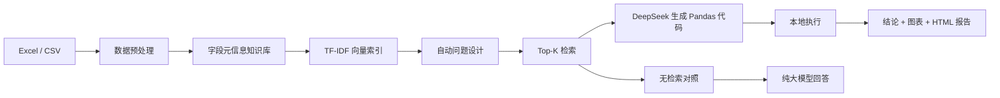
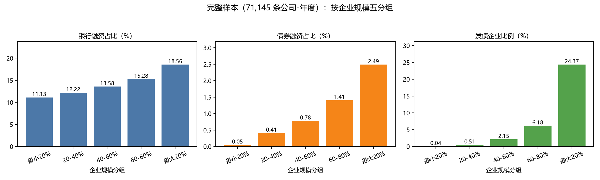

# NL2Data Agent · 自然语言数据分析助手

> 上传一份 Excel / CSV，用中文提问，自动完成 **数据预处理 → 字段知识库 → 问题设计 → RAG 检索 → Pandas 代码生成与执行 → 图表/报告**。
>
> 面向不会写 SQL / Pandas 的业务人员：把“数据在哪、怎么问、怎么算”交给 Agent，把“核对结论”留给人。

`Python 3.11` · `Streamlit` · `DeepSeek` · `RAG` · `pandas`

---

## 为什么做这个

很多中小企业和业务团队并不缺数据，缺的是**把数据变成结论的人**：

- 数据散在 Excel 里，分析依赖少数会写代码的同事；
- 直接问大模型，容易得到“听起来对、但没有数字”的回答，甚至编造；
- 真正可用的分析，需要**知道字段含义 + 会写代码 + 能核对结果**。

这个项目把这三件事串起来：先检索字段元信息，再让模型写 Pandas 代码，最后在本地真实数据上执行。答案附代码和计算过程，可以逐行复核。

---

## 功能

- **上传即分析**：支持 `.xlsx / .xls / .csv`，自动识别 CSMAR 三行表头（英文名 / 中文名 / 单位）
- **字段元信息知识库**：每个字段一条知识片段，包含类型、缺失、唯一值、统计量、高频取值、样例
- **自动问题设计**：根据字段自动生成统计、筛选、聚合、排序、趋势类问题
- **RAG 检索**：TF-IDF 字符 n-gram + 余弦相似度，取 Top-K 字段片段
- **代码生成与执行**：DeepSeek 生成 Pandas 代码，在本地执行，失败自动让模型修正一次
- **图表与报告**：每题自动出结果图；生成 Markdown / HTML 报告（浏览器可打印为 PDF）
- **对照评估**：同一个问题分别走 RAG 与“无检索”，自动比对关键数字，输出准确率对比
- **网页交互**：Streamlit 三个页签——数据特征 / 自动分析 / 追问

---

## 架构



核心原则：**模型负责“写”，本地负责“算”**。数字不是模型编的，是 Pandas 在真实 DataFrame 上算出来的。

---

## 快速开始

### 1. 准备环境

```bash
python -m venv .venv

# Windows
.venv\Scripts\activate
# macOS / Linux
source .venv/bin/activate

pip install -r requirements.txt
```

### 2. 配置 DeepSeek API Key

两种方式，二选一：

```powershell
# Windows PowerShell
$env:DEEPSEEK_API_KEY="sk-..."
```

或启动网页后，在左侧输入框直接填。

### 3. 启动网页

```bash
streamlit run app.py
```

浏览器打开 `http://localhost:8501`，上传 `data/sample_panel.csv`，点击「开始自动分析」。

### 4. 生成完整报告（可选）

```bash
# 把示例数据放到默认位置
copy data\sample_panel.csv data\公司年度面板.csv

python rag_assistant.py
```

输出：

```
outputs/实验报告.html      ← 浏览器打开，Ctrl+P 存 PDF
outputs/对比报告.md
outputs/图表_问题*.png
```

### 5. 用自己的两张原始表（可选）

把 `bond.xlsx`、`company.xlsx` 放进 `data/`，运行：

```bash
python prepare_panel.py
```

会按 `stkcd + 年份` 合并成“公司-年度”面板，并生成描述统计、规模分组、趋势图。

---

## 结果示例

以下结果来自完整 CSMAR 债券 + 公司财务数据（71,145 条公司-年度观测；原始数据因授权不随仓库提供）。



| 规模分组 | 银行融资占比 | 债券融资占比 | 发债企业比例 |
| --- | ---: | ---: | ---: |
| 最小 20% | 11.13% | 0.05% | 0.04% |
| 20–40% | 12.22% | 0.41% | 0.51% |
| 40–60% | 13.58% | 0.78% | 2.15% |
| 60–80% | 15.28% | 1.41% | 6.18% |
| 最大 20% | 18.56% | 2.49% | 24.37% |

规模越大，银行融资和债券融资占比都越高；债券融资的坡度更陡，说明直接债务融资对中小企业门槛更高。

---

## RAG 与“无检索”的对照

同一个问题，两次独立调用：

| 条件 | 模型能看到什么 | 典型回答 |
| --- | --- | --- |
| 无检索 | 只有问题 | “需要提供数据”“可以用 SQL 这样写……” |
| RAG | 字段元信息 + 统计量 + 真实 DataFrame | “银行融资均值 14.15%，中位数 11.01%” |

RAG 的答案附带可执行代码和计算过程，可以逐行复核；无检索的回答无法核对。报告会自动比对答案中的关键数字和代码执行结果，生成 `✅ / ❌ / 需人工` 判定。

---

## 技术栈

| 模块 | 选型 |
| --- | --- |
| 数据处理 | pandas / numpy |
| 检索 | scikit-learn `TfidfVectorizer`（char n-gram）+ 余弦相似度 |
| 大模型 | DeepSeek `deepseek-flash`（OpenAI 兼容接口） |
| 代码执行 | Python `exec`，本地 DataFrame，执行结果截断展示 |
| 网页 | Streamlit |
| 图表 | matplotlib / Streamlit 原生图表 |

---

## 目录结构

```
.
├─ app.py                  # Streamlit 网页：上传 / 自动分析 / 追问
├─ rag_assistant.py        # 核心：读表、知识库、检索、问答、代码执行、报告
├─ prepare_panel.py        # 债券 + 公司财务 → 公司-年度面板
├─ requirements.txt
├─ data/
│  └─ sample_panel.csv     # 500 行模拟数据，用于演示
├─ docs/
│  └─ result-quintiles.png
├─ scripts/
│  └─ make_sample.py       # 重新生成模拟数据与图表
└─ README.md
```

---

## 数据说明

- `data/sample_panel.csv` 是**模拟数据**：50 家公司 × 10 年，共 500 行，不对应任何真实公司。
- 完整 CSMAR 原始数据（债券 51 万条 + 公司财务 7.2 万条）因授权限制不随仓库提供。
- 想用自己的数据：直接在网页上传，或替换 `data/` 下的文件后运行 `prepare_panel.py`。
- 字段名建议用中文或可读英文；CSMAR 的三行表头会自动跳过。

---

## 限制

- 模型生成的代码在本地执行，请先检查再用于敏感数据；不要让它读写文件或联网。
- 分析结论是描述性统计，不是因果推断，也不构成投资建议。
- 自动出题的质量依赖字段名和字段说明；字段名越清晰，问题越有意义。
- 每次自动分析约调用 10–15 次大模型，耗时 1–3 分钟，会产生少量 API 费用。

---

## 作者

张安琦 · 天津大学管理与经济学部

代码仅供学习与交流使用。
